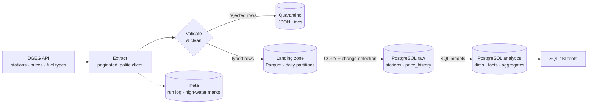
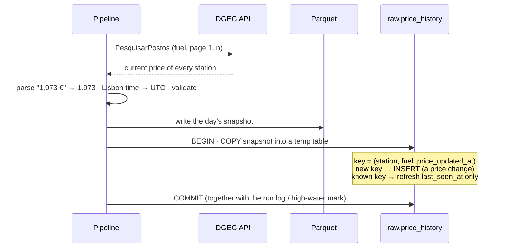
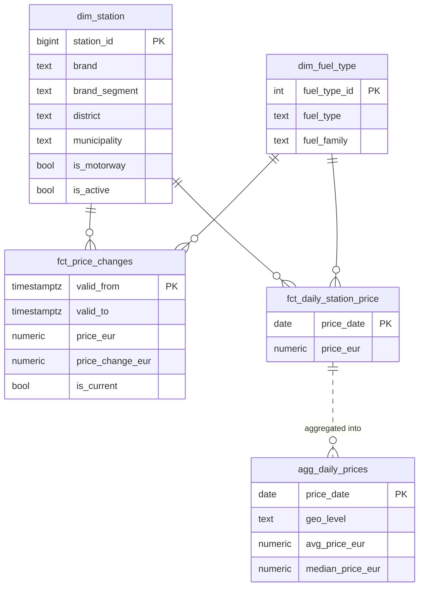

# Portugal Fuel Prices Pipeline

[](https://github.com/vitorhsc/fuel-prices-pipeline/actions/workflows/ci.yml)


**Where is fuel cheapest today, and how have prices changed?** This project answers an everyday
question with a production-style **batch data pipeline**. It ingests the prices of ~3 000 Portuguese
fuel stations from the public **DGEG API** every day, lands them as **Parquet**, and builds a
**PostgreSQL** warehouse with the full price history and analysis-ready tables.

| | |
|---|---|
| **Stack** | Python · REST API · PostgreSQL · Parquet (PyArrow) · Docker · GitHub Actions |
| **Concepts** | API ingestion · ETL/ELT · incremental loads (change detection) · SCD type 2 history · data quality & quarantine · idempotent loads · dimensional modelling |
| **Source** | [DGEG – Preços dos Combustíveis Online](https://precoscombustiveis.dgeg.gov.pt/) (Portuguese Directorate-General for Energy and Geology) |

**Visual guide** (in Portuguese): [project map](https://vitorhsc.github.io/fuel-prices-pipeline/mapa-do-projeto.html) ·
[the journey of one real price through every layer](https://vitorhsc.github.io/fuel-prices-pipeline/viagem-de-um-preco.html)

---

## The problem

The DGEG API only tells you the price **in force right now** at each station. It has no history
and no "what changed since yesterday" filter. To answer questions like *"did prices go up this
week?"* or *"which brand is cheapest on average?"*, the pipeline has to **build the history itself**.
It does this by taking a daily snapshot, detecting which prices changed and storing each price
version with its validity period.

## Architecture



| Layer | Where | What it holds |
|---|---|---|
| **Landing zone** | `data/raw/dgeg/<dataset>/snapshot_date=YYYY-MM-DD/*.parquet` | Immutable daily snapshots with an explicit schema. Lets you rebuild the warehouse without calling the API (`replay`). |
| **Quarantine** | `data/quarantine/...jsonl` | Rows that failed validation, with the reason. Nothing is silently dropped. |
| **raw** | `raw.stations`, `raw.price_history`, `raw.fuel_types` | Stations (latest attributes, first/last seen) and one row per **price version**. |
| **analytics** | see [Data model](#data-model) | Star-schema-style tables for analysis and BI. |
| **meta** | `pipeline_runs`, `pipeline_state` | Audit row per task (rows, rejects, new prices, API calls, warnings) and the newest price timestamp per scope. |

## How the incremental load works



* **Change detection on a natural key.** A price version is identified by
  `(station_id, fuel_type_id, price_updated_at)`. A key that is not in the history yet is a new
  price → inserted. A known key only has its `last_seen_at` refreshed. Each run pulls the full snapshot, but only the
  prices that actually changed are added to the history.
* **Idempotent.** Running twice, or replaying old Parquet files, never duplicates or reverts data.
  The insert/update split is counted with PostgreSQL's `xmax = 0` trick.
* **Atomic.** Each task's load commits in one transaction. A failure leaves the history untouched,
  and the next run picks up the same snapshot.
* **Freshness check.** If the newest price in a scope is older than `stale_source_hours`, the run
  logs a *stale source* warning. This catches a frozen API before anyone looks at a dashboard.

## Data model



| Table | Grain | Highlights |
|---|---|---|
| `dim_station` | station | Brand segment (hypermarket / major oil company / independent), motorway flag, active flag |
| `dim_fuel_type` | fuel type | Fuel family (diesel, petrol, LPG…) and premium grade |
| `fct_price_changes` | price version | **SCD type 2** validity (`valid_from`/`valid_to`), change vs previous price, weekday, capture lag |
| `fct_daily_station_price` | station × fuel × day | Price in force at the end of each day (versions expanded with `generate_series`) |
| `agg_daily_prices` | day × fuel × area | National, district and municipality stats in one pass with `GROUPING SETS` |
| `rpt_cheapest_stations` | municipality × fuel × rank | Top 3 cheapest stations right now vs local and national averages |

## Quickstart (Docker)

No API key needed.

```bash
git clone https://github.com/vitorhsc/fuel-prices-pipeline.git
cd fuel-prices-pipeline

make run        # starts PostgreSQL and runs the pipeline for the whole country
make run        # run again later: only price changes are inserted
```

Output of the first run against the real API (whole country, ~30 s, 29 API requests):

```text
dataset     scope                    status     rows rejected new prices
fuel_types  all                      success      14        0          0
prices      fuel=2101_district=all   success    2969        0       2969
prices      fuel=2105_district=all   success    2976        0       2976
prices      fuel=3201_district=all   success    3132        0       3132
prices      fuel=3205_district=all   success    1486        0       1486
prices      fuel=3400_district=all   success     532        0        532
prices      fuel=3405_district=all   success    1163        0       1163
prices      fuel=1120_district=all   success     437        0        437
Analytics models rebuilt: 6
```

> **Port 5432 already in use** (e.g. a local PostgreSQL)? Run `cp .env.example .env`, set
> `POSTGRES_PORT=5433` and the same port in `DATABASE_URL`, then use that port to connect below.

Explore the data:

* **Adminer** (web UI): <http://localhost:8080> — system *PostgreSQL*, server `postgres`, user/password `pipeline`, database `analytics`
* **psql**: `make psql`, then try [`analysis/example_queries.sql`](analysis/example_queries.sql)
* **Any BI tool** (Power BI, Tableau, Metabase…): `localhost:5432`, database `analytics`, schema `analytics`

To build a real history the pipeline has to run every day. Prices in Portugal usually change at
the start of the week.

### Run it automatically

**In the cloud (GitHub Actions + Neon).** [`scheduled.yml`](.github/workflows/scheduled.yml) runs the
pipeline at 10:00 and 22:00 UTC on GitHub's servers and loads a managed PostgreSQL on
[Neon](https://neon.com) (free plan), so no computer of yours has to be switched on. One-time setup:

1. Create a Neon project (region: Europe) and copy its connection string.
2. In the GitHub repository: *Settings → Secrets and variables → Actions → New repository secret*,
   name `DATABASE_URL`, value = the connection string.
3. *Actions → Scheduled run → Run workflow* to test it. Point DBeaver or Power BI at the same
   connection string.

Runs never overlap (`concurrency`), a failed run fails the workflow (GitHub emails you) and each
run's Parquet files are kept as a workflow artifact for 90 days. To copy history you already landed
locally into Neon: `docker compose run --rm -e DATABASE_URL='<neon url>' pipeline replay data/raw/dgeg`.
GitHub pauses scheduled workflows after 60 days without repository activity, and scheduled runs
can start a few minutes late.

**On your Mac (launchd).**

```bash
make schedule          # every day at 10:00 and 22:00, with launchd
make schedule-now      # start a run now, to test it
make schedule-status   # loaded? how many runs? last exit code?
make unschedule        # stop the automatic runs
```

[`scheduling/run_scheduled.sh`](scheduling/run_scheduled.sh) starts Docker Desktop if needed, skips
a run while the previous one is still going, writes everything to `logs/scheduled.log` and shows a
macOS notification when a run fails. If the Mac is asleep at the scheduled time, the run starts when
it wakes up. Two runs a day means a failed morning run (the API does have bad days) is picked up in
the evening, and a second successful run inserts nothing new because loads are idempotent.

Keep the project outside `~/Desktop`, `~/Documents` and `~/Downloads`: macOS privacy protection
blocks background jobs from reading those folders. On Linux, use cron to call the same script.

## Running locally without Docker

```bash
python -m venv .venv && source .venv/bin/activate
pip install -e ".[dev]"
cp .env.example .env            # points DATABASE_URL at localhost
make up                         # or use any PostgreSQL 13+
python -m fuel_prices run
```

## CLI

```bash
python -m fuel_prices run                             # all configured fuels, whole country
python -m fuel_prices run --districts 3               # only Braga district
python -m fuel_prices run --fuels 2101 3201           # only diesel and petrol 95
python -m fuel_prices lookups                         # list fuel type and district ids
python -m fuel_prices transform                       # rebuild analytics tables only
python -m fuel_prices replay data/raw/dgeg/prices     # reload Parquet files, no API calls
```

The command exits with code `1` if any task failed, so a scheduler can alert on it.

## Configuration

Behaviour lives in [`config/pipeline.yaml`](config/pipeline.yaml). The connection string comes from
the `DATABASE_URL` environment variable.

| Setting | Default | Description |
|---|---|---|
| `source.fuel_type_ids` | 7 road fuels | Diesel, petrol 95/98 (regular and premium), LPG |
| `source.district_ids` | `[]` (whole country) | Restrict to some districts, e.g. `[3]` = Braga |
| `source.page_size` | `500` | Rows per request |
| `source.request_delay_seconds` | `0.5` | Pause between requests, to be gentle with a public service |
| `quality.stale_source_hours` | `72` | Warn when no price changed for this long |

## Example analyses

From [`analysis/example_queries.sql`](analysis/example_queries.sql):

```sql
-- Where is diesel cheapest in my municipality right now?
SELECT price_rank, station_name, brand, price_eur, diff_vs_national_avg_eur
FROM analytics.rpt_cheapest_stations
WHERE municipality = 'Barcelos' AND fuel_type_id = 2101
ORDER BY price_rank;
```

Other examples: national daily price trend, cheapest districts, savings from choosing the right
station, hypermarkets vs. oil majors vs. independents, a brand price index, motorway premium, the
weekday on which prices change, biggest weekly increases, and pipeline observability.

## Data quality

| Check | Action |
|---|---|
| Price cannot be parsed, or is outside 0.30–5.00 € | Row rejected → quarantine |
| Missing or future update timestamp | Row rejected → quarantine |
| Coordinates outside mainland Portugal (or `0,0`) | Coordinates set to `NULL`, row kept |
| Stray whitespace in names and addresses | Normalised |
| API envelope `status: false` or unexpected shape | Task fails loudly (`DgegApiError`) |
| Schema drift (e.g. a text value in a numeric field) | Parquet write fails fast |
| No price update for longer than `stale_source_hours` | Warning in the run log |

## Testing & CI

```bash
make test-unit    # fast unit tests, no database
make test         # unit + integration tests against PostgreSQL (separate pipeline_test database)
make lint         # ruff check + ruff format --check
```

* **Unit tests** cover pagination by `Quantidade`, the error envelope, polite delays, retries with
  backoff and `Retry-After`, Portuguese price and date parsing (summer and winter time), validation
  rules and Parquet schema enforcement.
* **Integration tests** use an in-memory fake of the DGEG API (same payloads as the real one) and a
  real PostgreSQL. They cover the first load, detecting only changed prices, SCD history and daily
  expansion, replay idempotency, per-task failure isolation, district scoping and the stale-source
  warning.
* **GitHub Actions** runs lint and all tests against a PostgreSQL service container and builds the
  Docker image on every push.

## Design decisions

| Decision | Why |
|---|---|
| Build the history from daily snapshots | The source only exposes current prices. Snapshot + change detection is the standard way to get CDC from a source without change tracking. |
| Natural key `(station, fuel, price_updated_at)` | Uses the source's own timestamp, so a price seen in many snapshots is stored once. |
| Land Parquet before loading | Decouples extraction from loading, keeps an audit trail of what the API returned and allows replay without extra API calls. |
| `NUMERIC(6,3)` / Arrow `decimal128` for prices | Money is never stored as float. |
| Timestamps stored in UTC, dates computed in Lisbon time | The source uses local wall-clock time. Analytics dates follow the Portuguese calendar day. |
| Quarantine instead of drop | Bad rows stay inspectable and countable in the run log. |
| Analytics rebuilt in one transaction | Cheap at this scale, and BI users never see half-built tables. At larger scale this would become incremental models (e.g. dbt). |

**Known trade-offs:** if a station changes a price twice between two runs, only the last value is
seen, so the run frequency sets the resolution (daily is enough for Portuguese prices, which move
weekly). The brand segment is a documented heuristic in `02_dim_station.sql`.

## About the data source

The DGEG API is public and powers the official [precoscombustiveis.dgeg.gov.pt](https://precoscombustiveis.dgeg.gov.pt/)
website, but it is **not formally documented**, so endpoints may change. The client validates the
response envelope and schema so any change fails loudly instead of corrupting data. Please use it
responsibly: this pipeline makes a few dozen requests per run with a pause between them, and is
meant to run once a day. Data © DGEG.

## Project structure

```text
├── src/fuel_prices/
│   ├── client.py          # DGEG API client: envelope, pagination, retries, polite delays
│   ├── parsing.py         # parsing, cleaning, validation rules, Arrow schemas
│   ├── storage.py         # Parquet landing zone + quarantine
│   ├── warehouse.py       # PostgreSQL: COPY staging, change detection, state, transforms
│   ├── pipeline.py        # orchestration and replay
│   ├── cli.py             # command-line interface
│   └── sql/
│       ├── init/          # raw and meta DDL
│       └── transform/     # analytics models
├── scheduling/            # automatic runs on macOS (launchd job + wrapper script)
├── tests/                 # unit + integration tests, fake DGEG API
├── analysis/              # example analytical queries
├── docs/                  # visual guide (HTML, in Portuguese)
├── config/pipeline.yaml
├── docker-compose.yml     # PostgreSQL + Adminer + pipeline
├── Dockerfile
├── Makefile
└── .github/workflows/     # ci.yml (lint + tests + image build) · scheduled.yml (runs twice a day)
```

## Roadmap

- [ ] Schedule daily runs with Airflow (or a scheduled GitHub Action)
- [ ] Move the analytics layer to dbt with tests and docs
- [ ] Station services and opening hours (`GetDadosPosto`) as a second dimension
- [ ] Dashboard: price map and trends by district
- [ ] Enrich with Brent crude and fuel tax data to explain price movements

## License

[MIT](LICENSE)
